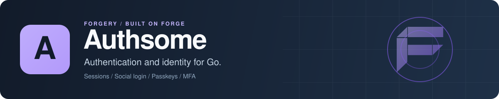

<p align="center">
  
</p>

# Authsome: authentication and identity for Go

Authsome is an authentication and user management engine for Go. The core gives you users, sessions with refresh tokens, organizations, RBAC, devices, apps and environments; every sign-in method (password, social login, magic links, passkeys and WebAuthn, MFA, SSO, phone, API keys) is a plugin you register, along with risk controls such as GeoIP, impossible travel and VPN detection. It runs inside your Go service against your own database, records every security event to [Chronicle](https://github.com/xraph/chronicle) and checks permissions with [Warden](https://github.com/xraph/warden), and it plugs into [Forge](https://github.com/xraph/forge) as an extension.

[](https://go.dev/dl/) [](https://github.com/xraph/authsome/actions/workflows/ci.yml) [](https://pkg.go.dev/github.com/xraph/authsome) [](https://github.com/xraph/authsome/stargazers)

[Documentation](https://www.xraph.com/docs/authsome) · [Quick start](#quick-start) · [Features](#why-authsome) · [Plugins](#plugins) · [Forge](#use-it-with-forge) · [Configuration](#configuration) · [Client SDKs](#client-sdks-and-ui) · [FAQ](#faq)

## Quick start

You need [Go 1.26 or later](https://go.dev/dl/).

```bash
go get github.com/xraph/authsome@latest github.com/xraph/chronicle@latest github.com/xraph/warden@latest
```

Save this as `main.go`. It runs an auth server with email and password sign-in, using in-memory stores for Authsome, its audit trail and its permissions:

```go
package main

import (
	"context"
	"log"
	"net/http"

	"github.com/xraph/chronicle"
	chstore "github.com/xraph/chronicle/store"
	chmemory "github.com/xraph/chronicle/store/memory"
	"github.com/xraph/forge"
	"github.com/xraph/warden"
	wmemory "github.com/xraph/warden/store/memory"

	"github.com/xraph/authsome"
	"github.com/xraph/authsome/api"
	"github.com/xraph/authsome/bridge/chronicleadapter"
	"github.com/xraph/authsome/middleware"
	"github.com/xraph/authsome/plugins/password"
	"github.com/xraph/authsome/store/memory"
)

func main() {
	ctx := context.Background()

	// Authsome records every security event to Chronicle and checks
	// permissions with Warden, so both are required.
	trail, err := chronicle.New(chronicle.WithStore(chstore.NewAdapter(chmemory.New())))
	if err != nil {
		log.Fatal(err)
	}
	authz, err := warden.NewEngine(warden.WithStore(wmemory.New()))
	if err != nil {
		log.Fatal(err)
	}

	engine, err := authsome.NewEngine(
		authsome.WithStore(memory.New()),
		authsome.WithChronicle(chronicleadapter.New(trail)),
		authsome.WithWarden(authz),
		authsome.WithDisableMigrate(), // the memory store has nothing to migrate
		authsome.WithPlugin(password.New()),
		authsome.WithBootstrap(authsome.WithBootstrapAppName("Acme")),
	)
	if err != nil {
		log.Fatal(err)
	}
	if err := engine.Start(ctx); err != nil {
		log.Fatal(err)
	}
	defer engine.Stop(ctx) //nolint:errcheck // example

	router := forge.NewRouter()
	router.Use(middleware.AuthMiddleware(engine.ResolveSessionByToken, engine.ResolveUser, nil))
	if err := api.New(engine).RegisterRoutes(router); err != nil {
		log.Fatal(err)
	}

	log.Printf("listening on :8080, app_id=%s", engine.PlatformAppID())
	log.Fatal(http.ListenAndServe(":8080", router.Handler())) //nolint:gosec // example
}
```

Authsome encrypts the tokens it stores, so give it a key, then run:

```bash
go mod tidy
export AUTHSOME_TOKEN_ENCRYPTION_KEY=$(openssl rand -hex 32)
go run .
# listening on :8080, app_id=aapp_...
```

Sign a user up, from another terminal. Put the `app_id` from the log line in the body:

```bash
curl -X POST http://localhost:8080/v1/signup \
  -H 'Content-Type: application/json' \
  -d '{"app_id":"aapp_...","email":"alice@example.com","password":"SecureP@ss123"}'
# {"session_token":"...","refresh_token":"...","expires_at":"...","user":{...}}

curl http://localhost:8080/v1/me -H 'Authorization: Bearer <session_token>'
```

`WithBootstrap` created a platform app with its default environments and roles on start, which is why you have an app ID to sign up against. Browser and mobile clients usually send an `X-Publishable-Key` header instead of the ID. One thing that catches people: `/v1/signin` refuses an account whose email isn't verified, because the `auth.require_email_verification` setting is on by default. Verify the address through `/v1/verify-email`, or switch the setting off for local work.

The OpenAPI spec for everything you've mounted is at `/.well-known/authsome/openapi`.

## Why Authsome?

Auth in a SaaS product grows sideways. You start with a password form and soon need Google sign-in, organizations with invitations, an admin who can see sessions, and a way to block a login from the wrong country. Authsome keeps those in one engine with one user model, and makes each extra method or control a plugin, so your binary only carries what you register and you add the next one when your customers ask for it.

| You need | Authsome gives you |
| --- | --- |
| Accounts | Sign-up, sign-in, sign-out, email verification, password reset and change, profile updates and account deletion |
| Sessions | Session and refresh tokens with configurable lifetimes, refresh rotation, a per-user session cap, session listing and revocation, and JWT or opaque token formats |
| Sign-in methods | Plugins for password, social login (22 providers including Google, GitHub, Apple and Microsoft), magic links, passkeys, MFA, SSO, phone and API keys |
| B2B tenancy | Apps and environments in the core, and organizations, members, invitations and teams through the `organization` plugin |
| Authorization | RBAC backed by [Warden](https://github.com/xraph/warden), with roles seeded from `.warden` files on bootstrap |
| An audit trail | Every security-relevant action recorded to [Chronicle](https://github.com/xraph/chronicle), with no silent fallback |
| Abuse controls | Rate limiting, account lockout and breached-password checks, plus GeoIP, geofencing, impossible travel, VPN detection, IP reputation and a risk engine as plugins |
| To be an identity provider | The `oauth2provider` plugin, and `agentauth` for AI agents acting on a user's behalf |
| Your database | PostgreSQL, SQLite and MongoDB through [Grove](https://github.com/xraph/grove), plus an in-memory store |
| Clients | A Go client, a TypeScript client, Dart and Flutter packages, and React, Vue and Next.js UI packages in this repo |

## Plugins

Nothing beyond the core is on until you register it. You pick. Pass each plugin to the engine with `authsome.WithPlugin`, or to the Forge extension with `WithPlugins`:

```go
authsome.WithPlugin(password.New()),
authsome.WithPlugin(mfa.New(mfa.Config{Issuer: "Acme"})),
authsome.WithPlugin(social.New(social.Config{
	Providers: []social.Provider{
		social.NewGitHubProvider(social.ProviderConfig{
			ClientID:     os.Getenv("GITHUB_CLIENT_ID"),
			ClientSecret: os.Getenv("GITHUB_CLIENT_SECRET"),
			RedirectURL:  "https://app.example.com/authsome/v1/social/github/callback",
		}),
	},
})),
```

| Category | Plugins |
| --- | --- |
| Authentication | `password`, `social`, `magiclink`, `passkey`, `mfa`, `apikey`, `sso`, `phone` |
| Identity | `organization`, `consent`, `subscription`, `waitlist` |
| Communication | `email`, `notification` |
| Risk and security | `anomaly`, `geofence`, `geoip`, `impossibletravel`, `ipreputation`, `riskengine`, `sharedsignals`, `vpndetect` |
| Provisioning | `scim`, `deviceverify`, `oauth2provider`, `agentauth` |
| Data | `retention` |

Some depend on others, so watch the order you register them in. `geofence`, `vpndetect` and `impossibletravel` read the location `geoip` resolves, so register `geoip` first, and `sso` and `scim` scope their connections to an organization. [plugins/README.md](plugins/README.md) has a "pick by what you are trying to do" table, the full dependency list and a README per plugin with its config, settings and endpoints.

## Storage backends

| Backend | Package | Constructor |
| --- | --- | --- |
| In-memory | `store/memory` | `memory.New()` |
| PostgreSQL | `store/postgres` | `postgres.New(db *grove.DB)` |
| SQLite | `store/sqlite` | `sqlite.New(db *grove.DB)` |
| MongoDB | `store/mongo` | `mongo.New(db *grove.DB)` |

All four pass the same store conformance suite in CI, so you can develop on SQLite and deploy on PostgreSQL. Plugins that keep their own tables (social connections, MFA factors, passkeys and others) ship a store per backend too, and the engine runs their migrations alongside its own on start unless you pass `WithDisableMigrate`. MongoDB needs a replica set, because app and organization deletes cascade inside transactions.

## Use it with Forge

The `extension` package registers Authsome as a [Forge extension](https://github.com/xraph/forge#extensions). It reads `extensions.authsome` (or a top-level `authsome` key), builds a store from the container's `*grove.DB`, mounts the API under `/authsome`, runs the bootstrap, and adds the auth middleware to your app.

```bash
go get github.com/xraph/authsome@latest github.com/xraph/chronicle@latest \
  github.com/xraph/warden@latest github.com/xraph/grove/extension@latest
```

```go
import (
	grove "github.com/xraph/grove/extension"

	authsome "github.com/xraph/authsome/extension"
	"github.com/xraph/authsome/plugins/mfa"
	"github.com/xraph/authsome/plugins/password"
	chronicle "github.com/xraph/chronicle/extension"
	warden "github.com/xraph/warden/extension"
)

app := forge.NewApp(forge.AppConfig{
	Name: "acme-api",
	Extensions: []forge.Extension{
		grove.New(),     // extensions.grove: driver and dsn
		chronicle.New(), // audit trail, required by authsome
		warden.New(),    // authorization, required by authsome
		authsome.New(
			authsome.WithPlugins(
				password.New(),
				mfa.New(mfa.Config{Issuer: "Acme"}),
			),
		),
	},
})
```

Order matters here, and you'll find out quickly if you get it wrong. Authsome looks for `chronicle.Emitter` and `*warden.Engine` in the container during `Register` and refuses to start without them, so list Chronicle and Warden first. Chronicle in turn wants you to decide who may call its admin API (see its README). Anything else it finds in the container gets wired up as a bridge: [Keysmith](https://github.com/xraph/keysmith) for API keys, [Relay](https://github.com/xraph/relay) for webhooks, [Herald](https://github.com/xraph/herald) for notifications, [Dispatch](https://github.com/xraph/dispatch) for background jobs and [Ledger](https://github.com/xraph/ledger) for billing. Without them it uses no-op bridges.

You still need `AUTHSOME_TOKEN_ENCRYPTION_KEY` (64 hex characters), or `AUTHSOME_TOKEN_ENCRYPTION_KEYS` as `kid:hex` pairs when you rotate, or an encryptor passed with `authsome.WithEngineOption(authsome.WithTokenEncryptor(...))`.

A service that should trust an Authsome deployment elsewhere can run the extension in client mode with `WithClientMode(portalURL)`, `WithServiceAPIKey` and `WithServiceAppID`.

## Configuration

```yaml
extensions:
  authsome:
    base_path: /authsome
    grove_database: primary          # optional; the default *grove.DB otherwise
    session:
      token_ttl: 1h
      refresh_token_ttl: 720h
      max_active_sessions: 5         # 0 means unlimited
      rotate_refresh_token: true
    password:
      min_length: 12
      algorithm: argon2id            # bcrypt by default; old hashes are rehashed on sign-in
      check_breached: true
    mailer:
      provider: resend               # resend or smtp; nothing is sent otherwise
      resend:
        api_key: re_your_resend_key
        from: auth@example.com
    bootstrap:
      app_name: Acme
      initial_owners: [founder@example.com]
```

The `Config` struct in [extension/config.go](extension/config.go) also covers `rate_limit`, `lockout`, `retention`, `csrf`, `webhooks`, per-app session settings under `apps`, bootstrap environments and `warden_dir` for your own role files, and the client-mode keys. In code, the extension takes `WithConfig`, `WithPlugin`, `WithPlugins`, `WithEngineOption`, `WithEngineOptions`, `WithBasePath`, `WithDisableRoutes`, `WithDisableMigrate`, `WithGroveDatabase`, `WithRequireConfig` and `WithLogger`.

Outside Forge, pass an `authsome.Config` with `authsome.WithConfig`, or use the individual engine options such as `WithBasePath`, `WithRateLimiter`, `WithLockoutConfig`, `WithDefaultTokenFormat` and `WithJWTFormat`. Settings that admins change at runtime, like email verification, live in the engine's settings manager.

## Client SDKs and UI

| Client | Where |
| --- | --- |
| Go | `github.com/xraph/authsome/sdk/go` (package `authclient`, `authclient.NewClient(baseURL)`) |
| TypeScript | [sdk/](sdk/), package `@authsome/client` |
| Dart | [sdk/dart](sdk/dart/) |
| Flutter | [flutter/packages](flutter/packages/): `authsome_core`, `authsome_flutter`, `authsome_flutter_ui` |
| React, Vue, Next.js | [ui/packages](ui/packages/): `@authsome/ui-core`, `@authsome/ui-components`, `@authsome/ui-react`, `@authsome/ui-vue`, `@authsome/ui-nextjs` |

The clients follow the OpenAPI spec the server serves at `/.well-known/authsome/openapi`, and `/.well-known/authsome/manifest` returns the service version, base path and available endpoints.

## Documentation

| Topic | Where |
| --- | --- |
| Getting started | [Getting started](https://www.xraph.com/docs/authsome/getting-started), [architecture](https://www.xraph.com/docs/authsome/architecture), [full example](https://www.xraph.com/docs/authsome/guides/full-example) |
| Sign-in methods | [Overview](https://www.xraph.com/docs/authsome/authentication/overview), [password](https://www.xraph.com/docs/authsome/authentication/password), [social login](https://www.xraph.com/docs/authsome/authentication/social-login), [passkeys](https://www.xraph.com/docs/authsome/authentication/passkeys), [MFA](https://www.xraph.com/docs/authsome/authentication/mfa), [SSO](https://www.xraph.com/docs/authsome/authentication/sso), [OAuth2 provider](https://www.xraph.com/docs/authsome/authentication/oauth2-provider) |
| Organizations | [Overview](https://www.xraph.com/docs/authsome/organizations/overview), [members](https://www.xraph.com/docs/authsome/organizations/members), [teams](https://www.xraph.com/docs/authsome/organizations/teams), [environments](https://www.xraph.com/docs/authsome/environments/overview) |
| Security | [RBAC](https://www.xraph.com/docs/authsome/security/rbac), [rate limiting](https://www.xraph.com/docs/authsome/security/rate-limiting), [lockout](https://www.xraph.com/docs/authsome/security/lockout), [audit trail](https://www.xraph.com/docs/authsome/security/audit-trail), [webhooks](https://www.xraph.com/docs/authsome/security/webhooks) |
| Integrations | [Forge extension](https://www.xraph.com/docs/authsome/guides/forge-extension), [bridges](https://www.xraph.com/docs/authsome/bridges/overview), [custom plugin](https://www.xraph.com/docs/authsome/guides/custom-plugin), [Next.js app](https://www.xraph.com/docs/authsome/guides/nextjs-app), [UI](https://www.xraph.com/docs/authsome/ui/overview) |
| Storage and API | [Stores](https://www.xraph.com/docs/authsome/stores/overview), [HTTP API](https://www.xraph.com/docs/authsome/api-reference/http-api) |

The Go API is on [pkg.go.dev](https://pkg.go.dev/github.com/xraph/authsome).

## Examples

[`_examples/standalone`](_examples/standalone/) and [`_examples/forge`](_examples/forge/) show the engine on its own and as a Forge extension. Both are behind the current API: the standalone one doesn't pass a Warden engine, so `NewEngine` refuses it, and the Forge one doesn't register Chronicle or Warden. Follow the quick start and the Forge section above until they're updated.

## FAQ

### How do I add authentication to a Go web app?

Build an engine with a store, Chronicle, Warden and the plugins you want, mount the API on a Forge router, and add `middleware.AuthMiddleware` so handlers can see the current user. Under Forge, the extension does all of that from config.

### Does Authsome support social login and passkeys?

Yes, through the `social` plugin (22 OAuth providers, among them Google, GitHub, Apple, Microsoft and Discord) and the `passkey` plugin for WebAuthn.

### Can Authsome handle multi-tenant B2B apps?

Yes. Apps and environments are part of the core, and the `organization` plugin adds organizations, memberships, invitations and teams, with org-scoped roles through Warden.

### Why does Authsome need Chronicle and Warden?

Every security event has to land in an audit trail, and every permission check needs an authorization engine. If you leave either out, Authsome refuses to start, because an auth server that can't tell you who did what is the one thing your auditor won't accept.

### Can I use Authsome without Forge?

Partly. The engine and stores are plain Go, but the HTTP API registers on a Forge router (`forge.NewRouter()`), which you can serve with the standard `net/http` server as the quick start does.

## Contributing

Issues and focused pull requests are welcome on [GitHub](https://github.com/xraph/authsome/issues).

```bash
git clone https://github.com/xraph/authsome.git
cd authsome
GOWORK=off go test ./...     # memory and SQLite
make check                   # fmt, vet, golangci-lint and govulncheck
make test-integration        # PostgreSQL and a MongoDB replica set, needs Docker
```

`make test-integration` runs the same store conformance suite as CI's Postgres and MongoDB job, starting a fresh Mongo replica set each time, because several of those tests leave rows behind that would break a second run against the same database. Commits follow [Conventional Commits](https://www.conventionalcommits.org/). [SECURITY.md](SECURITY.md) explains how to report a vulnerability.

## License

See the [Authsome repository](https://github.com/xraph/authsome) for license terms.

Authsome is part of the [Forge](https://github.com/xraph/forge) forgery stack, built by [Rex Raphael](https://github.com/juicycleff) and [contributors](https://github.com/xraph/authsome/graphs/contributors).
